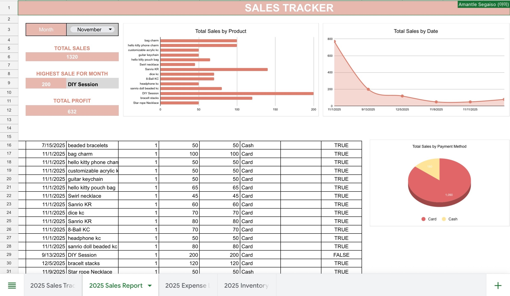

# Order Pipeline: a low-cost order system for a small shop

A Google Forms + Google Sheets + Apps Script system that turns customer orders into clean, trackable data, built for my accessories brand in Gaborone, Botswana.



## The problem

I wanted customers to order online, but I did not want to pay for a Shopify-style website for a small side business. A Google Form is free, but its responses are messy: one row per customer, one column per product, and variants squashed into a single cell. That is hard to use for packing orders, delivery fees or sales analysis.

## The solution

```
Google Form  ->  Form_Responses sheet  ->  Apps Script  ->  Orders sheet  ->  Packing_View  ->  Sales dashboard
 (customer)       (raw, messy)            (cleans it)      (one row per        (what to pack)    (built by hand
                                                            product line)                         in Sheets)
```

When a customer submits the form, the script runs automatically and writes one clean row per product to an `Orders` sheet. From there I can see what to pack and track sales by product, date, payment method and month.

## What the script does (`Code.gs`)

| Function | Purpose |
|---|---|
| `onFormSubmit` | Trigger that processes each new form submission automatically |
| `processSpecificRow` | Reads one form response and writes its order lines |
| `generateOrderID` | Creates readable IDs like `ORD-20260131-001`, numbered per day |
| `getProductPrice` | Looks up the selling price in the `Product_Master` sheet |
| `getDeliveryCost` | Looks up the fee for the chosen pick-up or delivery spot in `Delivery_Zones` (home delivery defaults to P50) |
| `refreshPackingView` | Builds a packing checklist: one row per order, products listed, with tick boxes |
| `hideCompletedOrders` / `showAllOrders` | Hide packed orders, or bring them all back |
| `processAllFormResponses` | Processes every existing response (used for backfilling) |

Each order line records: Order ID, timestamp, customer, phone, delivery location and cost, product, variant, quantity, unit price, line total, payment method and order total.

## Sheets it expects

- `Form_Responses`: the form's raw responses
- `Orders`: the clean output
- `Product_Master`: product names (column A) and selling prices (column E)
- `Delivery_Zones`: location names (column A) and fees (column B)
- `Packing_View`: created automatically by `refreshPackingView`

Product columns in the form are named like `TOAST KEYCHAIN- P35`; the script strips the price from the header and matches the name to `Product_Master`.

## Setup

1. Create a Google Form linked to a Google Sheet. Rename the responses tab to `Form_Responses`.
2. Add the other sheets above, with the columns described.
3. Open **Extensions -> Apps Script**, paste in `Code.gs`, and save.
4. Add a trigger: `onFormSubmit`, event source "From spreadsheet", event type "On form submit".
5. Use `refreshPackingView` to rebuild the packing list whenever needed.

## What I learned and what is next

- **Real use:** the Orders sheet has run my shop's orders since early 2026, with delivery zones and mobile payments.
- **The dashboard is manual.** The charts and totals (sales, profit, best sellers, month filter) are built by hand in Sheets, not by this script.
- **Known limitations:**
  - Running `processAllFormResponses` twice creates duplicate rows, because there is no duplicate check.
  - If a product name in the form does not match `Product_Master`, the price comes back as 0 and a warning is logged.
  - Order confirmations to customers are sent by hand.
- **Ideas:** a duplicate check, automatic confirmation messages, and a script-driven monthly summary.

## Privacy

The sheet itself is not included because it contains customer names and phone numbers. The screenshot above shows only totals and charts.

## Author

Amantle Aone Segaiso, MEng Data Science candidate (Stellenbosch University) and founder of a small accessories brand in Gaborone.
